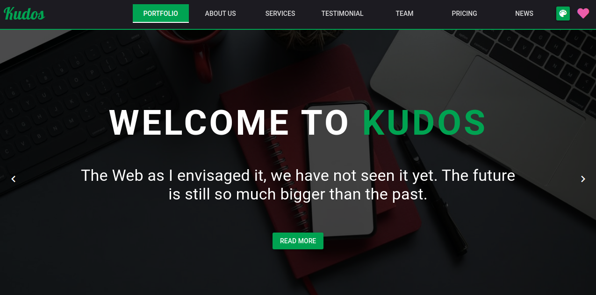
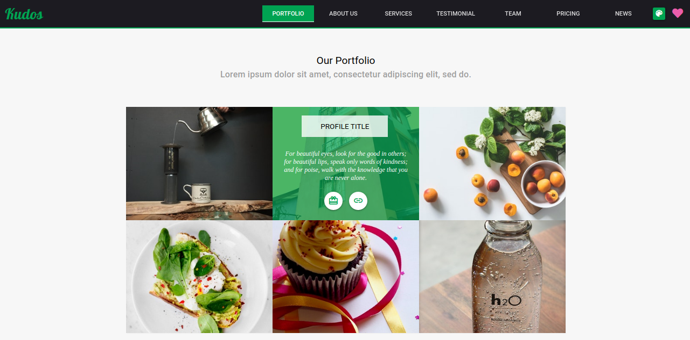
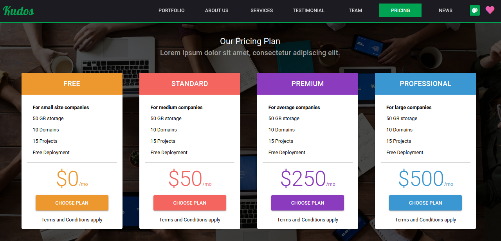
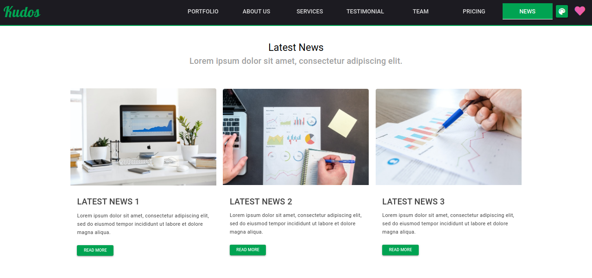

# Infinite Frames - Official Website

[](https://quasar.dev/)
[](https://vuejs.org/)
[](LICENSE)
[]()
[]()

Welcome to the official repository for **Infinite Frames**, a contemporary, high-performance company profile and creative media studio website built with **Vue.js** and the **Quasar Framework**.

The website delivers an engaging, interactive digital presence showcasing our creative portfolio, core philosophy, multi-disciplinary services, client testimonials, team members, pricing packages, latest news, and a complete contact hub featuring primary and alternative contact channels.

---

## Table of Contents

- [About Infinite Frames](#about-infinite-frames)
- [Key Features](#key-features)
- [Official Contact & Alternative Details](#official-contact--alternative-details)
- [Technology Stack](#technology-stack)
- [Project Structure](#project-structure)
- [Prerequisites](#prerequisites)
- [Installation & Setup](#installation--setup)
- [Available Scripts](#available-scripts)
- [UI Showcase](#ui-showcase)
- [Customization Guide](#customization-guide)
- [License](#license)

---

## About Infinite Frames

**Infinite Frames** is a cutting-edge creative agency and digital production studio specializing in web experiences, brand storytelling, visual design, and interactive media. This web application serves as our digital front door, crafted to deliver smooth animations, tactile feedback, and adaptable themes.

---

## Key Features

- **Live Theme Customizer**: An integrated palette picker allowing visitors and clients to dynamically customize the website's primary theme color in real-time.
- **Hero Carousel Banner**: Full-bleed cinematic carousel featuring smooth slide transitions, animated typography, and instant call-to-action navigation.
- **Interactive Portfolio Showcase**: Powered by `@quasar/quasar-ui-qflashcard` with 3D hover effects, slide-ins, and direct project exploration links.
- **Corporate Philosophy & Values**: Animated presentation cards highlighting studio vision, rules, and core missions.
- **Comprehensive Services Grid**: Highlighting studio capabilities in Web Design, Graphics Design, Blockchain, WordPress development, DevOps, Big Data, and AI solutions.
- **Client Testimonials Carousel**: Rotating client feedback and recommendations.
- **Team Spotlight**: Interactive team cards with flashcard interactions and social connectivity.
- **Transparent Tiered Pricing**: Structured pricing tiers (Free, Standard, Premium, Professional) with clear feature breakdowns.
- **Latest News & Insights**: Dedicated articles and studio news cards with hover animations.
- **Advanced Contact & Alternative Details Hub**:
  - Dedicated Contact Us section and navigation tab.
  - Complete contact information cards featuring **both primary and alternative details** (phone numbers, email addresses, studio locations, and business hours).
  - An interactive contact form with fields for primary and alternative contact details.
  - Live client-side validation and feedback notifications.
  - Global footer with direct quick-action buttons (call primary, call alternative, email primary, email alternative, and social channels).

---

## Official Contact & Alternative Details

To ensure seamless communication, **Infinite Frames** provides multiple verified communication channels, including primary lines and alternative channels:

| Contact Channel | Primary Detail | Alternative / Secondary Detail | Availability & Notes |
| :--- | :--- | :--- | :--- |
| **Brand Name** | **Infinite Frames** | Infinite Frames Creative Studio | Official Registered Brand |
| **Primary Email** | `contact@infiniteframes.com` | `support@infiniteframes.com` | Client inquiries & general assistance |
| **Alternative Email** | `info@infiniteframes.com` | `press@infiniteframes.com` | Media, careers, and urgent support |
| **Primary Phone** | `+1 (555) 234-5678` | `+1 (555) 876-5432` | Mon – Fri (9:00 AM – 6:00 PM EST) |
| **Alternative Phone / WhatsApp** | `+1 (555) 987-6543` | `+1 (800) 555-0199` | Mobile support & WhatsApp messaging |
| **Studio Headquarters** | 100 Innovation Way, Suite 400<br>San Francisco, CA 94105 | 456 Media Blvd, Studio 12<br>New York, NY 10001 | On-site studio visits by appointment |
| **Operating Hours** | Mon – Fri: 9:00 AM – 6:00 PM EST | Sat: 10:00 AM – 4:00 PM EST | 24/7 Priority Online Ticket Desk |
| **Official GitHub** | [github.com/infiniteframes](https://github.com/infiniteframes) | &mdash; | Open-source tools & repositories |
| **Social Media** | [Twitter / X (@infiniteframes)](https://twitter.com/infiniteframes) | [LinkedIn](https://linkedin.com/company/infiniteframes) | News, updates & studio reels |

---

## Technology Stack

- **Core Framework**: [Vue.js](https://vuejs.org/) (v2.6)
- **UI & Component Suite**: [Quasar Framework](https://quasar.dev/) (v1.x)
- **Card Animations**: `@quasar/quasar-ui-qflashcard` (Flashcard interactive effects)
- **Styling**: Sass / SCSS, Material Design, Quasar Flex Grid
- **Icon Packs**: Material Icons, FontAwesome 5
- **Fonts**: Lobster Script, Roboto
- **HTTP Client**: [Axios](https://github.com/axios/axios)
- **Internationalization**: [Vue I18n](https://kazupon.github.io/vue-i18n/)
- **Bundler & Tooling**: Webpack 4 via `@quasar/app` CLI

---

## Project Structure

```text
Infinite-Frames/
├── assets/                     # Static presentation previews and screenshots
│   ├── home.png
│   ├── news.png
│   ├── portfolio.png
│   └── pricing.png
├── src/
│   ├── assets/                 # App assets (SVG illustrations, graphics)
│   ├── boot/                   # Boot plugins (axios, i18n)
│   ├── components/             # Reusable UI components
│   │   └── EssentialLink.vue
│   ├── css/                    # Global stylesheets and theme variables
│   │   ├── app.sass            # Global typography & font rules
│   │   └── quasar.variables.sass # Quasar theme tokens
│   ├── i18n/                   # Language translation dictionaries
│   │   └── en-us/
│   ├── layouts/                # Layout templates
│   │   └── MainLayout.vue
│   ├── pages/                  # Main route views
│   │   ├── Error404.vue        # Custom 404 page
│   │   └── Index.vue           # Infinite Frames single-page portal
│   ├── router/                 # Vue Router configuration
│   │   ├── index.js
│   │   └── routes.js
│   ├── statics/                # Public assets, images, icons, and fonts
│   │   ├── fonts/
│   │   ├── icons/
│   │   └── images/             # Hero, portfolio, team, and background graphics
│   ├── App.vue                 # Root Vue application component
│   └── index.template.html     # HTML entry template
├── quasar.conf.js              # Quasar build & app configuration
├── package.json                # Project dependencies & scripts
├── LICENSE                     # MIT License
└── README.md                   # Project documentation
```

---

## Prerequisites

Ensure you have the following installed on your development machine:

- **Node.js**: Recommended **Node.js 16 LTS** (`v16.20.2`) or Node 14.
  > [!WARNING]
  > Modern Node.js versions (e.g. **Node.js 24**) will fail during `npm install` with `node-sass` / `node-gyp` C++ compilation and Python errors because this project uses Quasar v1 (Webpack 4 / LibSass). Use **Node 16 LTS** via `nvm-windows` to install precompiled binaries instantly without Python or C++ build tools.

- **npm** `>= 6.13.4` or **Yarn** `>= 1.21.1`
- **Quasar CLI** (Optional but recommended globally):
  ```bash
  npm install -g @quasar/cli
  ```

---

## Installation & Setup

1. **Clone the repository**:
   ```bash
   git clone https://github.com/infiniteframes/infinite-frames-website.git
   cd Infinite-Frames
   ```

2. **Install project dependencies**:
   ```bash
   npm install
   # or with yarn:
   yarn install
   ```

3. **Start the development server**:
   ```bash
   quasar dev
   # or via npx:
   npx quasar dev
   ```
   The application will start locally at `http://localhost:8080` with hot-module replacement and error reporting enabled.

---

## Available Scripts

### Development Mode
```bash
quasar dev
```
Launches a local development server with instant hot reload.

### Production Build
```bash
quasar build
```
Compiles and minifies assets into the `dist/spa` folder ready for deployment to any static hosting provider (e.g. Netlify, Vercel, AWS S3, Cloudflare Pages, or Apache/Nginx).

### Cross-Platform Targets
The Quasar configuration supports multiple build targets:
```bash
# Build as Progressive Web App (PWA)
quasar build -m pwa

# Build as Desktop Application (Electron)
quasar build -m electron

# Build as Mobile Application (Cordova / Capacitor)
quasar build -m cordova
```

---

## UI Showcase

The Infinite Frames website features a cohesive dark-accented visual theme with interactive sections:

| Home & Hero Banner | Portfolio Gallery |
| :---: | :---: |
|  |  |

| Pricing Tiers | Latest News |
| :---: | :---: |
|  |  |

---

## Customization Guide

### Updating the Brand Name
The brand name is configured centrally across:
- **Navigation & Hero**: [`src/pages/Index.vue`](src/pages/Index.vue)
- **App Configuration**: [`quasar.conf.js`](quasar.conf.js)
- **Package Manifest**: [`package.json`](package.json)
- **HTML Title**: Auto-populated via `productName` in `quasar.conf.js` / `src/index.template.html`.

### Updating Contact Details
- Contact information cards and inputs can be modified directly in the Contact Us section inside [`src/pages/Index.vue`](src/pages/Index.vue#L700-L850).
- Update primary/alternative phones, emails, office locations, and working hours to match any operational changes.
- Form inputs support dual email and phone collection (`email`, `alt_email`, `phone`, `alt_phone`).

### Modifying Theme Colors
- Users can switch colors at runtime using the color picker in the top toolbar.
- The default initial theme color is defined in `Index.vue` (`theme_color: 'rgb(0, 163, 82)'`).
- Global Quasar variable overrides can be set in [`src/css/quasar.variables.sass`](src/css/quasar.variables.sass).

---

## License

This project is licensed under the [MIT License](LICENSE).
Copyright (c) 2026 **Infinite Frames**. All rights reserved.
